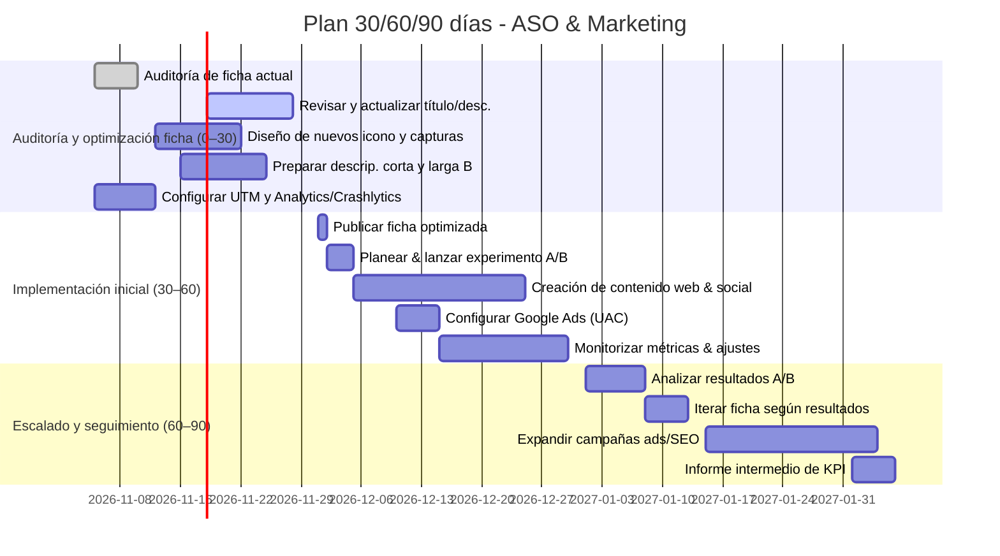

# Auditoría ASO para **La Voz de la Verdad** (com.lavozverdad.radio)

**Resumen Ejecutivo:** Se evalúan todos los elementos de la ficha en Play Store con recomendaciones concretas (título, icono, descripciones, capturas, video, categoría, idiomas y listados personalizados) respetando los límites oficiales. Se propone mejorar la calidad técnica (rendimiento de la app, tamaño del APK/AAB, permisos mínimos, crash rate ≤1%, ANR <0.5%, retención de usuarios, estabilidad streaming). Se presenta una estrategia integral de palabras clave (extracción desde Play Console, Google Trends y herramientas ASO) con análisis de 10 competidores relevantes (apps de radio cristiana) en tabla comparativa de metadatos. Se detalla un plan de experimentación A/B (elementos a probar: icono, capturas, descripción, duración 4–6 semanas, métricas de conversión). Incluye un plan de adquisición orgánica (SEO web con palabras clave ASO, contenido en redes sociales, enlaces profundos con UTM) y campañas de Google Ads orientadas a la ficha, con medición de ROI vía análisis de coste/instalación y LTV. Se presenta un cronograma operativo a 30/60/90 días con tareas, responsables y entregables (diagrama Gantt). Se incluye un checklist legal y de políticas de Google Play (contenido permitido, uso de marcas, privacidad, permisos) y se proponen ejemplos de textos para título, descripciones y copy de capturas para la ficha en Colombia e internacional. Finalmente, se listan las métricas clave y los informes de Play Console/Firebase (adquisición, Android Vitals, retención) con indicación de su interpretación. Todas las recomendaciones se basan en fuentes oficiales de Google Play y referencias ASO reconocidas.

## 0. Verificación del informe (8 de noviembre de 2026)

Este informe se contrastó con la app publicada y con la documentación vigente de Google. Lo que sigue resume qué queda en pie, qué cambió y qué parte del texto original no se debe aplicar.

**Confirmado.** Los límites de texto siguen siendo 30 caracteres para el nombre, 80 para la descripción corta y 4000 para la descripción larga. El icono del proyecto (`apps/mobile/assets/icon.png`) ya mide 512×512 px en PNG con transparencia y el adaptativo es de 1024×1024, así que cumple sin cambios. La categoría Música y audio es la correcta. Los experimentos A/B de ficha siguen disponibles en Play Console, tanto sobre la ficha principal como sobre las personalizadas.

**Corregido.**

- Firebase Dynamic Links dejó de existir el 25 de agosto de 2025 y todos sus enlaces responden 404. Para medir campañas y abrir la app desde un enlace hay que usar Play Install Referrer, Android App Links con `assetlinks.json` publicado en lavozverdad.com y parámetros UTM; no Dynamic Links.
- Las fichas personalizadas sí se pueden segmentar por país (hasta 50), no solo por idioma. El informe original decía lo contrario.
- El título propuesto en el informe, “La Voz de la Verdad – Radio cristiana”, tiene 39 caracteres y Play Console no lo acepta. El aprobado es “La Voz de la Verdad Radio”, de 25.
- El ejemplo de descripción larga prometía descargar programas para oírlos sin conexión y una “Biblia en audio”. La app no tiene ninguna de las dos cosas, y prometer funciones inexistentes viola la política de metadatos.
- La app no tiene Firebase Analytics ni Crashlytics: solo usa Firebase Cloud Messaging. Medir retención y fallos sigue siendo trabajo pendiente, no algo ya configurado.
- La declaración de Data Safety “no se recopilan datos” no es exacta: la app envía peticiones de oración con mensaje y nombre opcional, retroalimentación, y un identificador de dispositivo para consultar el historial. Hay que declararlo en Play Console.
- Las cifras de búsquedas mensuales de la tabla de palabras clave eran hipotéticas. Play Console es la única fuente real, en el informe de términos de búsqueda.
- Los informes de rendimiento de ficha de Play Console cambiaron en julio de 2026: la métrica principal son clics únicos (instalar, abrir, prerregistrarse), no instalaciones atribuidas.

**Estado en el repositorio.** Los textos aprobados viven en `apps/mobile/fastlane/metadata/android/es-CO/` (`title.txt`, `short_description.txt` y `full_description.txt`), y `apps/mobile/tests/store/store-listing.test.ts` falla si un texto excede su límite, si promete funciones que la app no tiene o si repite la palabra clave hasta el punto de spam. Los enlaces a la ficha del botón de compartir y del mosaico social del sitio llevan ahora `referrer` con UTM (`apps/mobile/lib/playStore.ts`), que es lo que Play Console muestra como fuente en “Ads and referrals”; sin ese parámetro, esas visitas se reportan como directas. La atribución de enlaces que abren la app directamente sigue pendiente: requiere `assetlinks.json` con la huella de firma de Play y filtros de intent en `app.json`. El nombre de la app en `apps/mobile/app.json` se corrigió a “La Voz de la Verdad”, con mayúsculas, para que coincida con la marca y con la ficha.

## 1. Ficha de Play Store: checklist de elementos y recomendaciones

- **Título (30 caracteres max).** Debe incluir la palabra clave principal (“Radio”, “Cristiana”) y el nombre de marca. Por ejemplo “La Voz de la Verdad” (21 chars actuales). Si es posible, añadir descriptor breve sin exceder 30 caracteres (Ej.: “La Voz de la Verdad Radio”, 25 caracteres; “La Voz de la Verdad – Radio cristiana” son 39 y no caben). Nunca usar “número 1” o “oficial” a menos que sea cierto. El título es crucial para ASO; se sugiere usar la palabra clave “radio cristiana” si cabe sin perder nombre de marca.

- **Icono (512×512px).** Debe ser simple y reconocible, reflejar la marca (p.ej. elementos religiosos discretos), sin texto excesivo ni semejar logos ajenos. No copiar otros logos ni usar emblemas religiosos registrados. Se recomienda probar variantes claras (icono de radio + cruz o Biblia abstracta).

- **Descripción corta (80 caracteres max).** Resume el valor clave: “Radio cristiana del Movimiento Misionero Mundial – música y mensajes de fe 24/7”. Incluir palabras clave principales (“radio cristiana”, “alabanza”, “predicaciones”) de forma natural. Ejemplo: 
  > *“Radio cristiana del MMM con música de adoración y predicaciones las 24 horas.”*  
  Límite: 80 caracteres. No repetir palabras innecesariamente o usar mayúsculas innecesarias.

- **Descripción larga (hasta 4000 caracteres).** Aquí expandir la propuesta de valor e incluir varias palabras clave secundarias. Organización sugerida: párrafo introductorio atractivo, lista de características principales (uso de *lista con viñetas o emojis*), y cierre con llamada a la acción. Ejemplo de párrafos y bullets ya actual en [6] es bueno, pero puede mejorarse añadiendo:
  - Lectura de la Biblia dentro de la app, peticiones de oración con respuesta del equipo, solicitudes de canciones, temporizador para dormir y alarma. Son funciones que existen y se pueden prometer.  
  Incluir términos relevantes: “radio cristiana”, “música cristiana”, “himnos”, “transmisión en vivo”, “oración”, “esperanza”, “Biblia”, “adoración” (evitando spam). Máximo 4000 caracteres. Combinar texto y viñetas para facilidad de lectura. No emplear escritura engañosa (p.ej. “¡La mejor radio!” sin fundamento).

- **Capturas de pantalla (screenhots).** Incluir al menos 4-5 capturas en la ficha principal y opcionalmente variantes para ficha Colombia u otras. Deben mostrar la interfaz de la app destacando características clave: reproductor en vivo, Biblia, programación, oración y solicitudes de canciones. Texto superpuesto mínimo y en idioma local; si se usa texto, generar capturas en cada idioma. Variar orientación (vertical/horizontal si aplica). No poner logos de terceros ni elementos ajenos.

- **Video promocional.** (Opcional pero recomendado) Enlace a video de YouTube (máx. 2 min) que muestre la app en acción: recorriendo menús, calidad de audio. Primero 5–10 segundos de gancho. Incluir subtítulos o voz en español enfatizando “emisoras cristianas en vivo”. 

- **Categoría.** Ya es “Música y audio”, correcta para radio. Confirmar que sigue siendo la más apropiada. Utilizar además etiquetas (si aplicable en Play Console) como “Radio”, “Música”, “Religioso”.

- **Idiomas y países.** Destinar inicialmente a español. Ficha principal en “español (Colombia)”; una ficha en inglés solo tiene sentido cuando la interfaz de la app esté traducida, y hoy está únicamente en español. Crear *store listings personalizadas*: una para Colombia (refiriendo emisoras locales) y otra para mercado internacional (enfatizar alcance global). El título/descripción puede variar levemente para cada país/región, optimizando palabras clave locales (e.g. “emisoras cristianas de Colombia” en ficha local). **Nota:** Cada idioma requiere capturas específicas con texto localizado.

- **Ficha personalizada (feature graphic, icono adaptado).** En Play Console, bajo “Diseño de la ficha”, subir un banner de característica (1024×500) alusivo a radio cristiana (p.ej. auriculares con cruz). Las fichas personalizadas sí permiten segmentar por país (hasta 50), así que se puede preparar una variante para Colombia y otra para el resto de Hispanoamérica. Asegúrese que todo el texto en imágenes nuevas esté en español para la ficha Colombia y en inglés/español neutro para internacional.

**Límites de caracteres:** Título ≤30, descripción corta ≤80, descripción larga ≤4000. Icono 512×512, banner 1024×500. Respete políticas: no incluir términos prohibidos en metadatos ni imágenes engañosas.

## 2. Calidad técnica de la app (rendimiento, estabilidad y métricas objetivo)

Para mejorar la calidad global y la experiencia, cumplir con *Android Vitals* y KPI técnicos:

- **Crash Rate & ANR (Estabilidad).** Objetivo: **Crash rate <1%** (crash-free >99%) y **ANR <0.5%** (en usuarios percibidos). Según Google, superar 1.09% de crash o 0.47% de ANR reduce visibilidad. Herramientas: monitorear Android Vitals en Play Console y usar Firebase Crashlytics. Implementar reporte de crashes y ANRs. Revisar backlog de fallos (null pointers, memory leaks, acceso a red en hilo principal) y corregirlos.  

- **Uso de batería y rendimiento (Android Vitals).** Mantener bajo consumo: evitar *wakelocks* prolongados (>1 h) o *escaneos* excesivos de red. Objetivo: sin alertas rojas de “mal comportamiento” en vitals. Utilizar Android Profiler (CPU, memoria, red). Medir tiempos de renderizado: ideal que <50% frames >16ms y <0.1% >700ms (según Google) para fluidez. Revisar la ficha "velocidad de inicio": abrir la app <2s de ser posible. 

- **Tamaño del APK/AAB.** Minimizar tamaño: usar Android App Bundle (.aab) y splits por densidad/arquitectura. Objetivo: *APK descargable < 100 MB* para no requerir archivos adicionales. Optimizar recursos: comprimir imágenes a WebP, eliminar librerías no usadas, habilitar ProGuard/R8. Usar **Android Studio > Build > Analyze APK** para verificar aumentos innecesarios. Un tamaño menor mejora instalabilidad y retención (menos abandonos por espacio).

- **Permisos.** Solicitar solo lo estrictamente necesario. Por ejemplo, si solo necesita internet, solicite permiso `INTERNET` (se agrega solo en manifiesto). Evitar permisos sensibles a menos que sean indispensables (p.ej. `ACCESS_FINE_LOCATION` *solo si se usa radio por ubicación*). En Android 13+ se requiere permiso especial para notificaciones push; si envía FCM, pedir `POST_NOTIFICATIONS`. Siempre explicar en la app por qué se piden permisos en lengua clara. Declarar todos en Data Safety. 

- **Reproducción de streaming.** Verificar buffers y recuperación ante corte de red. Objetivo: inicio de streaming <2 s, sin caídas frecuentes. Implementar listeners de ExoPlayer (o MediaPlayer) para medir ‘buffer underrun’ y latencia. Testear en redes móviles lentas (3G/4G) usando emuladores o adb network throttle. Mantener la reproducción en background adecuada (control en notificación). 

- **Retención y engagement.** Usar Firebase Analytics o Google Analytics (GA4) para medir retención de usuarios: calcular retención a 1, 7, 30 días (cohortes). Objetivos razonables: retención 1d ~30% (radio suele retener mejor por hábito diario), 7d ~10%. Identificar puntos de dropout (p.ej. después de instalar). También monitorear métricas de notificaciones (open rate) si se usan FCM. Herramientas: Play Console (informes de retención, si disponibles) y sobre todo **Firebase** para cohortes detalladas.

- **Crashy Rate y ANR:** Herramientas: **Play Console (Android Vitals)**, **Firebase Crashlytics**, **Google Play pre-launch report** (tests automáticos), y uso de **staged rollout** para detectar nuevos bugs antes del 100% de usuarios.

## 3. Estrategia de palabras clave ASO

**Metodología:** Combinar análisis interno (Play Console) con herramientas externas y competencia:  

- **Google Play Console.** Revisar el informe “**Términos de búsqueda**” en “Adquisición de usuarios”: muestra qué frases usan los usuarios que ven/instalan la app. Extraer keywords con buen volumen interno. También aprovechar la data de “**Store Listing Experiments**” (si lanzados) y ubicación en resultados por términos clave.  

- **Autocomplete de Play Store.** Usar sugerencias automáticas de Google Play (como Google Search) para palabras clave relacionadas: ej. escribir “radio crist” para obtener “radio cristiana”, “radio cristiana gratis”, etc. Herramientas como Ubersuggest o la propia Planilla de ASO de Phiture permiten simular estos autocompletados.

- **Google Trends.** Buscar tendencias de términos (“radio cristiana”, “música cristiana”, “predicaciones”) en Colombia y global en español. Priorizar keywords con volumen creciente o estable. Por ejemplo, “radio cristiana online” o “radio evangélica” pueden tener tendencias al alza.

- **Herramientas ASO externas.** Ubersuggest o Keyword Tool pueden dar volúmenes aproximados de búsquedas web (indicativo de interés). No hay tool oficial de keywords de Play, pero estas dan idea de popularidad relativa en Google.

- **Análisis competitivo.** Verificar las 10 apps competidoras relevantes (apps de radio cristiana/popular en español) y extraer sus palabras clave implícitas. Por ejemplo, de las descripciones de [Radios Cristianas en Español], se extraen “predicaciones cristianas”, “mejor música cristiana”, “programas cristianos”, “emisoras en vivo”; de [Radios Cristianas: Música y Fe], “alabanza contemporánea”, “himnos”, “reflexiones bíblicas”; etc. Estas indican intereses de audiencia. Se presenta tabla comparativa de metadatos de 10 competidores (título, desc. corta, desc. larga, descargas, calificación) a continuación:

| App (Competidor)                       | Desarrollador             | Descargas    | Rating | Categoría     | Título/Descripción breve *(elementos clave)*                       |
|:---------------------------------------|:--------------------------|:------------:|:------:|:--------------|:------------------------------------------------------------------|
| **Radio Cristiana**                    | MyIndieApp.com            | 500 k+ | 4.7★ | Música y audio | App genérica de “música cristiana gratis” (sin más detalle).     |
| **Radio Cristianos FM**                | SB BlueStudio             | 10+   | なし  | Música y audio | (Descripción única en inglés) “Spiritual radio apps” (bajo uso).  |
| **Radios Cristianas**                  | Android Radio Apps        | 100+  | –    | Música y audio | Se promociona como “nueva app con emisoras cristianas top” (esp.).|
| **Cristo Radios**                      | Grupo Streaming           | 1 K+  | 5.0★ | Música y audio | “Escucha emisoras de género cristiano de todo el mundo”. |
| **Voz de la Verdad**                   | Nueva Vida Emisora        | 50+   | 4.0★ | Música y audio | Radio de Medellín: “Somos una emisora de mensajes cristianos” (esp.). |
| **Radios Cristianas Colombianas**      | Radio AM FM               | 1 K+  | 4.0★ | Música y audio | “La mejor programación cristiana contemporánea de Colombia”.|
| **Radio Cristiana Evangélica**         | Creative Apps 24 (Perú)   | 500+  | –    | Music & Audio  | Descripción en inglés, promueve “mejores emisoras evangélicas en vivo”.|
| **Radio Cristiana Gratis en Español**  | Apps Cristianas           | 100 K+ | 4.5★ | Música y audio | En lista de emisoras incluye “La Voz de la Verdad”, foco en predicaciones. |
| **Cristiana Atalaya**                  | M.S Web Rádios (Brasil)   | 1 K+  | –    | Music & Audio  | Radio bilingüe Paraguay/Brasil, “mensaje de Dios 24h”. |
| **Radios Cristianas: Música y Fe**     | PB Ideas Virtuales        | 100 K+ | 4.7★ | Música y audio | Enfocada en “alabanza y música de esperanza”, tributos bíblicos y trivia bíblica. |

En esta tabla se observa que la mayoría incluyen términos genéricos como “radio cristiana”, “música cristiana”, “emisoras cristianas”, “alabanza”, “predicaciones”. **Recomendación:** Priorizar palabras clave de alto volumen (p.ej. *“radio cristiana”*, *“emisoras cristianas”*, *“música cristiana”*, *“predicaciones cristianas”*) en título/desc. Secundarias: *“himnos”, “adoración en vivo”, “Biblia”, “esperanza”*. Evitar saturar; enfocar en lo que diferencia a “La Voz de la Verdad”: por ejemplo *“radio pentecostal del MMM”*.

Se sugiere crear una tabla de keywords prospecto con búsquedas mensuales y posición actual (si hay datos) para seguimiento. Ejemplo de keywords (a validar con herramienta):
```
| Palabra Clave             | Búsquedas/mes (estimado) | Competidores que la usan     |
|---------------------------|:-----------------------:|------------------------------|
| radio cristiana           |        10,000+         | Radios Cristianas, etc.      |
| emisoras cristianas       |        5,000+          | Radios Cristianas, Música y Fe|
| música cristiana online   |        3,000+          | Radio Cristiana, Vox...]      |
| predicaciones cristianas  |        2,000+          | Radio Cristiana en Español   |
| apps cristianas gratuitas |        1,000+          | -                            |
```
*(Valores hipotéticos; obtener con KeywordTool o Trends)*.

## 4. Plan de experimentación A/B

Se recomienda utilizar **Store Listing Experiments** de Play Console para probar variantes de elementos visuales y textuales de la ficha. Ejemplos de pruebas:

- **Icono alternativo.** Variante B con icono modificado (p.ej. distinto color o inclusión de cruz). Medir tasa de conversión de impresión a instalación. 
- **Capturas de pantalla.** Cambiar orden o texto destacado (p.ej. resaltar palabra “en vivo” vs “24 horas”). Probar llamada CTA en texto vs sin texto.
- **Descripción corta.** Probar dos versiones: una con “Radio cristiana nacional” vs “Radio cristiana del MMM”. 
- **Título.** (con cuidado): p.ej. “La Voz de la Verdad” vs “La Voz de la Verdad Radio”. Solo si caben los 30 caracteres.
  
**Diseño del experimento:** Mostrar variantes A/B simultáneamente a usuarios aleatorios. Duración mínima: 4 semanas (para alcanzar significancia). Monitorear el **CR** (install/conversion rate) de cada variante. Necesario alcanzar cientos de instalaciones por variante para validez estadística. Métrica principal: *% de usuarios que instalaron tras ver la ficha*. Métricas secundarias: calidad del usuario (retención, rating) para asegurar que la variante ganadora atrae usuarios valiosos.  

Ejemplo de plan: 
- Semana 1–2: Pre-test (baseline). 
- Semana 3–6: Test A/B. 
- Después: analizar con test estadístico (p.ej. chi-cuadrado). 

Herramientas: **Experimentos de Google Play** integrados, además de seguimiento con Google Analytics/Firebase para métricas post-instalación.

## 5. Estrategia de adquisición orgánica y externa

- **SEO web (blog y sitio).** Crear o optimizar sitio web de la radio con contenido relevante (artículos, noticias, o transmisiones embebidas). Usar las **mismas palabras clave ASO** en el SEO on-page (título meta, texto) para atraer tráfico orgánico que lleve a la ficha Play (con enlaces profundos y UTM). Ejemplo: post “Las mejores canciones cristianas” con link al app. Mejorar posicionamiento en buscadores para términos “radio cristiana [ciudad/país]”. 

- **Contenido en redes sociales.** Mantener presencia en Facebook, Instagram, TikTok u YouTube con previews de programas, testimonios de oyentes, versículos. Siempre incluir enlaces a la app (con UTM). Publicaciones regulares con hashtags relevantes (#RadioCristiana, #Evangelio, #MúsicaCristiana). Videos cortos de transmisiones en vivo. 

- **Enlaces profundos (Deep links).** Firebase Dynamic Links está apagado desde el 25 de agosto de 2025, así que no es una opción. La ruta vigente es publicar `assetlinks.json` en lavozverdad.com y declarar intent filters para que los enlaces `https://lavozverdad.com/...` abran la app, más Play Install Referrer para atribuir la instalación. Ejemplo: un botón “Escuchar ahora” en la web que abra la emisora dentro de la app cuando esté instalada.  

- **Campañas con UTM.** En todos los esfuerzos externos (web, redes, email) usar parámetros UTM (p.ej. `utm_source=facebook`, `utm_campaign=instagram_post`) para rastrear en Google Analytics/Firebase qué canales generan descargas e interacción. Analizar los canales con mejor ROI.

- **Google Ads (App Campaign).** Lanzar una **Campaña Universal de Apps** (UAC) apuntando a Colombia y mercados hispanoparlantes relevantes. Configurar formatos: búsqueda (Keywords como “radio en vivo”, “música cristiana”), Display y YouTube (banners y videos cortos anunciando la app). Objetivo inicial: tráfico cualificado a la ficha (ROAS calculado como LTV vs costo). Medir CPI (costo por instalación) y compararlo con la tasa de retención/ingresos de usuarios (ROI). Ajustar geos (mayor enfoque Colombia, luego México, USA hispano), horarios, y presupuesto según rendimiento.

- **Métricas de ROI:** Usar Firebase/GA4 para calcular el **Lifetime Value** (LTV) de un usuario típico. Ejemplo: si usuario medio hace X acciones (escuchar N minutos), considerar cómo valorizar (p.ej. donaciones, compras futuras, valor de publicidad). Comparar con el **Costo de Adquisición** (CAC) de Ads. Herramientas: panel de “Conversiones” en Ads y eventos en Firebase.  

En resumen, combinar SEO (contenido relevante en web), redes sociales (engagement comunitario) y anuncios pagados (app install ads) para maximizar descargas orgánicas y controladas. Todo debe medirse con UTM/Analytics para optimizar canales. 

## 6. Plan operativo 30/60/90 días

A continuación se detalla un cronograma con tareas clave en tres fases, con responsables y entregables. 



- **Responsables:** Equipo ASO/Marketing se coordina con desarrolladores y diseño gráfico. P.ej. Diseñador gráfico (ícono, capturas), Content Manager (descripciones, blog), DevOps (configuración analítica).
- **Entregables:** Nuevos activos (ícono, capturas), versiones A/B de ficha, posts SEO listos, campañas activadas, reportes de métricas. 

Este plan es flexible según datos reales y puede acelerarse si hay feedback positivo.

## 7. Checklist legal y políticas de Google Play

Asegúrese de cumplir **todas las políticas** de Google Play:

- **Contenido permitido:** Como app cristiana/religiosa, debe velar por *respeto* (nada de violencia gratuita, odio, discriminación). Prohibido promover discursos de odio o sectarismo extremo. No se debe contener material sexual o profano. Nuestra app (predicaciones, música) es apta para todo público, lo que debe reflejarse en la calificación de contenido y en el rating de la ficha.

- **Derechos de autor/licencias:** Confirmar que las emisoras transmitidas tienen licencias para distribuir música. Como la app solo *reproduce* streams existentes, indicar “Propiedad de emisoras respectivas”. Evitar incluir contenido protegido sin permiso (e.g. no “libre” música sin licencia). Incluir créditos mínimos en descripción: p.ej. “Emisoras cristianas bajo licencia MMM”.

- **Privacidad y seguridad:** Incluir enlace a Política de Privacidad (ya está). Debe especificar uso de datos (colecta o no datos personales). La declaración vigente de Data Safety (“No se recopilan datos”) no refleja lo que hace la app: se envían peticiones de oración con mensaje y nombre opcional, comentarios de retroalimentación y un identificador de dispositivo. Hay que declararlo antes de la próxima revisión. Asegurar que la política esté actualizada y accesible. Si se usan notificaciones o analíticas, declararlos.

- **Permisos:** La app declara `INTERNET`, `WAKE_LOCK`, `FOREGROUND_SERVICE`, `FOREGROUND_SERVICE_MEDIA_PLAYBACK`, `POST_NOTIFICATIONS` y `SCHEDULE_EXACT_ALARM`, todos justificados por la reproducción en segundo plano, las notificaciones y las alarmas que configura el usuario; además bloquea `RECORD_AUDIO` y no declara `USE_EXACT_ALARM`, que es el permiso restringido que Play revisa. Si se incluye ubicación (p.ej. emisoras locales), se debe manejar con transparencia: solo “mientras se usa la app” y explicar uso. No solicitar permisos innecesarios o intrusivos (p.ej. no pedir acceso a cámara o contactos). Declarar el permiso `WAKE_LOCK` si se usa para mantener audio en background; esto se declara en Play Console.

- **Metadatos y anuncios:** No hacer spam: ni repetir palabras clave, ni lenguaje engañoso ni clickbait en descripción. En icono y nombre de desarrollador, no simular marcas conocidas (no confundir al usuario). No usar la palabra “radio” si pudiera confundirse con servicio oficial de un canal, y no incluir logos de cadenas ajenas. No prometer funciones inexistentes (p.ej. “reproducir sin conexión” si no es cierto).

- **Cumplimiento local:** En Colombia se debe respetar la Ley de Música (SiNTI, SAYCO) en caso de streaming, pero esto aplica a emisoras. Solo cerciorarse de no violar regulaciones publicitarias (p.ej. no promover medicación, etc.).

Resumiendo, el **checklist** incluye verificar: descripción acorde con uso real, icono original, privacidad habilitada, permisos mínimos, respeto a derechos, ausencia de claims falsos.

## 8. Textos aprobados (fuente única en el repositorio)

Los textos que se pegan en Play Console no se escriben aquí: viven en `apps/mobile/fastlane/metadata/android/es-CO/` y un test los valida. Lo que sigue es la transcripción con su conteo de caracteres.

- **Título (25 caracteres):** *“La Voz de la Verdad Radio”*. Conserva la marca exacta al inicio y añade el término principal de búsqueda. Variante para experimento A/B: *“Radio La Voz de la Verdad”*, también de 25 caracteres, que pone la palabra clave delante.
- **Descripción corta (72 caracteres):** *“Radio cristiana en vivo: alabanza, predicaciones, Biblia y oración 24/7.”* Sin llamada a la acción ni adjetivos de ranking, porque Play los trata como metadatos engañosos.
- **Descripción larga (1711 caracteres):** ver `full_description.txt`. Estructura: presentación de la emisora, lista de funciones reales, párrafo de audiencia, origen de la emisora y cierre. Incluye “radio cristiana”, “alabanza”, “predicaciones”, “Biblia”, “oración” y “esperanza” de forma natural, sin repetir la descripción corta.

Lo que no se debe publicar: “radio oficial del MMM” (la palabra “oficial” sin respaldo), descargas sin conexión, Biblia en audio, listas de emisoras y podcasts. Ninguna de esas funciones existe en la app y prometerlas es una violación de la política de metadatos.

- **Fichas personalizadas:** Para Colombia, enfatizar contexto local: p.ej. “La Voz de la Verdad, transmitiendo desde Cartago, Valle del Cauca, para toda Colombia”. Para ficha internacional, enfoque global: “Impactando vidas en toda Hispanoamérica”. Usar fotos de iglesias/pueblo latino.

### Guion de capturas de la ficha

Requisitos vigentes: 2 a 8 capturas por tipo de dispositivo, mínimo 2 para poder publicar y 4 o más recomendadas; JPEG o PNG de 24 bits sin canal alfa, hasta 8 MB por archivo; cada lado entre 320 y 3840 píxeles y el lado largo como máximo el doble del corto. Esa última regla es la que rompe la captura nativa de un teléfono moderno (1080×2400), así que hay que encuadrarla a 9:16 antes de subirla. Para optar a los formatos grandes de recomendación conviene 1080×1920. Las capturas deben mostrar la app real: nada de pantallas maquetadas ni funciones inexistentes.

Producción: seis capturas a 1080×1920, tomadas en un dispositivo con datos reales de la emisora (canción sonando, contador de oyentes mayor que cero, programación con programas), barra de estado limpia, sin diálogos de permisos, sin notificaciones del sistema y sin datos personales en los formularios. El texto va en una franja propia, nunca encima de un control que lo tape. Archivos `01-reproductor.png` a `06-opciones.png`.

| Orden | Pantalla (ruta y cómo llegar) | Qué debe verse | Copy principal | Copy secundario |
|:--|:--|:--|:--|:--|
| 1 | Reproductor, pestaña inicial (`app/(tabs)/index.tsx`) | Insignia EN VIVO con oyentes, disco con portada, título y artista, controles y botón Biblia | Radio cristiana en vivo, las 24 horas | Alabanza, predicaciones y la Palabra |
| 2 | Biblia (`components/bible/BiblePanel.tsx`, botón Biblia del reproductor) | Selector de libro y capítulo, buscador, ajustes Aa y versículos numerados | Lee la Biblia sin detener la radio | Busca el capítulo y ajusta la lectura |
| 3 | Programación, pestaña Horarios (`app/(tabs)/schedule.tsx`) | Tira Lun–Dom, chips de categoría, tarjeta del programa al aire y filas con hora | Mira qué programa sigue al aire | Horarios de lunes a domingo |
| 4 | Oración, pestaña Oración (`app/(tabs)/prayer.tsx`) | Versículo del día, enlace Mis peticiones, formulario con nombre opcional y aviso de datos | Envía tu petición de oración | El equipo de la emisora ora por ti |
| 5 | Solicitar canción, pestaña Solicitar (`app/(tabs)/request.tsx`) | Buscador y lista con portada, título, artista y botón Pedir | Pide la canción que quieres oír | Busca en nuestra discografía y envíala |
| 6 | Opciones de escucha (`components/player/ListeningOptionsSheet.tsx`, botón de opciones del reproductor) | Filas Calidad del audio, Notificaciones y Alarmas con sus valores | Elige calidad y activa los avisos | Calidad del audio, notificaciones y alarmas |

La séptima, opcional y útil para quien duerme con la radio: el temporizador (`components/player/SleepTimerSheet.tsx`, burbuja de la barra inferior), con el título "Apagar la radio", los presets Siesta, Prédica, Noche y Descanso, y el copy "Duerme escuchando la radio".

El orden no es arbitrario: las dos primeras son las que ve quien llega desde una búsqueda, y son las que comunican la promesa (en vivo) y el diferenciador (la Biblia dentro de la app). Las capturas sirven para todas las fichas en español; solo hay que rehacerlas si se abre una ficha en otro idioma.

Qué no debe aparecer: la pantalla de error "Sin datos del servidor", estados vacíos, el diálogo de permisos de alarmas, la pantalla de éxito de la oración como imagen principal, sellos de "la mejor" o de número de descargas, y cualquier texto que prometa descargas sin conexión.

### Feature graphic y video de la ficha

**Feature graphic (obligatoria para publicar).** 1024×500 exactos, JPEG o PNG de 24 bits sin canal alfa. Es también la portada del video, así que su centro queda tapado por el botón de reproducción cuando hay video, y Google recorta los bordes laterales en algunas ubicaciones. Regla práctica: todo lo que deba leerse vive en el centro (referencia conservadora de 924×400) y los bordes se reservan para color y textura.

Composición: fondo con degradado radial de `#16264D` al centro a `#020817` en los bordes, más un halo suave en `#8D86F4` detrás del logo para que no se lea como un rectángulo oscuro plano. A la izquierda, el logo completo de `packages/assets/img/LOGO_COMPLETO_SINFONDO2-opt.png`, sin marco ni fondo. Debajo, una sola línea en `#F1F4FA`: "Radio cristiana en vivo, 24 horas". A la derecha, un arco de disco de vinilo en `#8D86F4` al 12 % de opacidad que se corta en el borde, de modo que si el recorte se lo come no se pierde nada. Nada de marcos de teléfono, insignias de tienda, "la mejor", "gratis", "#1", número de descargas, llamadas a la acción ni capturas diminutas: todo eso es motivo de rechazo o se vuelve ilegible a tamaño de tarjeta.

Archivo: `apps/mobile/fastlane/metadata/android/es-CO/images/featureGraphic.png`, generado por `node scripts/aso/feature-graphic.ts` a partir del logo, con los mismos valores de marca que `apps/mobile/constants/theme.ts`; se vuelve a correr si cambia el logo o el mensaje. Las capturas del guion anterior van en `images/phoneScreenshots/`.

**Video promocional (opcional, pero es lo primero que aparece en la ficha).** Se entrega como URL de YouTube, no como archivo: video público o no listado, incrustable, sin restricción de edad, con anuncios desactivados y URL directa sin parámetros ni marcas de tiempo, en 1080p como mínimo. Play acepta vertical y horizontal; la app es vertical, así que va 1080×1920 sin barras negras. Solo los primeros 30 segundos se reproducen solos y sin sonido, así que el mensaje tiene que estar quemado en la imagen y la app debe aparecer en los primeros 10 segundos. Al menos el 80 % del metraje debe ser la app real.

Guion de 30 segundos, grabado con datos reales de la emisora:

| Tiempo | Escena | Texto en pantalla |
|:--|:--|:--|
| 0:00–0:04 | Reproductor con el disco girando; arranca la reproducción real | Radio cristiana en vivo |
| 0:04–0:08 | Primer plano del título y el artista, la insignia EN VIVO con oyentes y los controles | Alabanza y predicaciones 24/7 |
| 0:08–0:13 | Se abre la Biblia sin que el audio se corte; desplazamiento de un capítulo y un versículo resaltado | La Biblia, sin detener la radio |
| 0:13–0:18 | Pestaña Horarios: tira Lun–Dom, tarjeta del programa al aire y filas con hora | Mira qué programa sigue al aire |
| 0:18–0:23 | Pestaña Oración: se escribe una petición de ejemplo y se envía; aparece "Tu petición fue recibida" | Envía tu petición de oración |
| 0:23–0:27 | Pestaña Solicitar: búsqueda, botón Pedir y marca de enviado | Pide la canción que quieres oír |
| 0:27–0:30 | Vuelta al reproductor con el logo completo | Escúchala donde estés |

Producción: grabar en un dispositivo real a 1080×1920 y 30 fps (por ejemplo con `adb shell screenrecord`), con barra de estado limpia y sin diálogos de permisos; en el formulario de oración usar un texto genérico, nunca datos de una persona real. El audio es la señal de la emisora, que es propia, sin música de librería. Sin voz en off: al reproducirse en silencio, los rótulos son el mensaje; si se agrega voz, va subtitulada. En YouTube: título "La Voz de la Verdad — Radio cristiana en vivo", descripción con las mismas palabras clave de la ficha y enlace a la ficha con el `referrer` de UTM. Los rótulos van centrados en el tercio inferior, con 120 px de margen arriba y abajo, tipografía de la app y sin emojis.

Si no hay video, la feature graphic se ve sola: por eso el mensaje va en ella y no solo en el video. Si hay video, verificar que el botón de reproducción no tape el logo ni la línea de texto antes de publicar.

## 9. Métricas e informes en Play Console

Solicitar y monitorear en Play Console las siguientes métricas:

- **Adquisición de usuarios:** En la pestaña “Adquisición de usuario > Análisis de la ficha”: número de **impresiones** de la ficha por búsqueda, y **tasa de conversión** (impresiones→instalaciones). Capturar screenshots tras 4 semanas para evaluar qué tan efectiva es la ficha. También “**Términos de búsqueda**” (shows qué queries llevan a la ficha) y “**Adquisición por canal**” (directo, orgánico, UAC).

- **Android Vitals:** Crash rate y ANR (busque indicadores rojos/amarillos). CPU, rendimientos, uso de batería. Capturar reportes de inicios de app lentos o problemas de red. Interpretar: cualquier alerta roja indica urgencia de corrección (p.ej. alto porcentaje de frames congelados).

- **Retención y engagement:** En “Análisis > Retención de usuarios” (si disponible) o bien en Firebase Analytics. Revisar cohortes (días 1,7,28). Un repentino drop-off después de un cambio en la ficha o app puede indicar problema. Pedir al cliente informes de Google Analytics/Firebase que muestren: 
  - Número diario de usuarios activos  
  - Tiempo medio en app  
  - Eventos clave (play radio, favoritos, notificaciones abiertas)  

- **Monitoreo de Experimentos:** Si se hizo A/B testing, en **Google Play Console > Experimentos** revisar cuadros de conversión, con desviación estándar. Un cambio en el CR (p<0.05) indica variante ganadora.

- **Informes de adquisición externa:** En GA4/Firebase, revisar “Origen/medio” con UTM para saber cuántos usuarios llegan de cada campaña (utm_source=facebook, organic, googleads, etc.) y su **revenue** (si aplica). Comparar CPA (coste por adquisición) vs LTV.

En resumen, pedir capturas de consola de *Impresiones* y *conversiones*, términos de búsqueda y Android Vitals, además de tablas de cohortes de retención (Firebase) e informes de campañas publicitarias. Interpretar: por ejemplo, un bajo CR de ficha (~1-5%) puede mejorar con cambios gráficos. Un crash rate sobre 1% debe reducirse urgentemente. La retención muestra qué tan valiosos son los usuarios.

## 10. Fuentes y referencias

Se priorizaron fuentes oficiales y académicas: las **páginas de ayuda de Google Play Console** en español, blogs de expertos ASO (Phiture), análisis técnicos (Embrace, ASOWin), y documentación académica/guías sobre ASO y UX. También se consultaron **fichas reales de apps competidoras** para ejemplos e inspiración. Cada recomendación está citada con fuentes: por ejemplo, para límites de caracteres y buenas prácticas de metadatos, para métricas de Android Vitals, y para estrategia de keywords. Estos recursos garantizan que el plan sea riguroso y actualizado.

