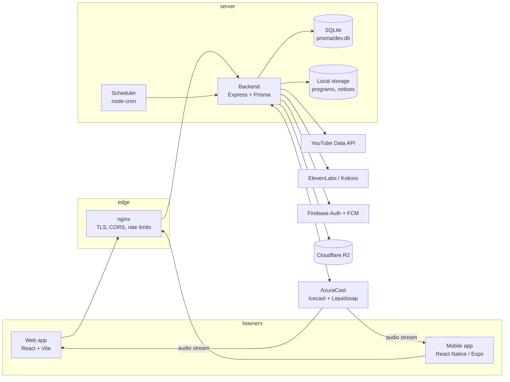
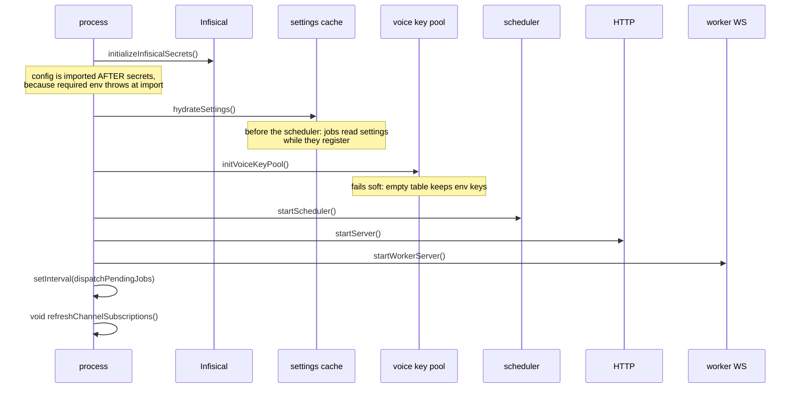
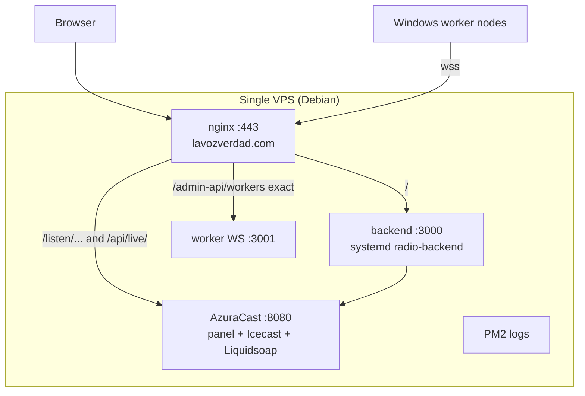

# Architecture

The repository is not a radio player. It is the layer around AzuraCast: the
listener apps, the admin panel, and a backend that turns YouTube channels into
station content, voices the hourly announcements, watches the stream and
restores itself when something breaks.

## System context

## Trust boundaries

The backend is the only component that holds privileged credentials. AzuraCast
API keys, the Icecast streamer password, the ElevenLabs key pool, the webhook
secret and FCM credentials never leave the server. Web and mobile talk only to
the backend, which shapes each response for its audience.

| Boundary | Authentication | Notes |
| --- | --- | --- |
| Browser or app → `/api/*` | none, or a bearer capability (`deviceId`) | Public data. Never contains admin-only fields. |
| Browser → `/admin-api/*` | JWT bearer from `POST /admin-api/auth/google` | Permissions come from the database on every request |
| Browser → `/panel-api/*` | `x-panel-secret` header | AzuraCast panel proxy used by authenticated sessions |
| AzuraCast → `/webhook/*` | `x-webhook-secret` header | Facebook callbacks |
| YouTube hub → `/admin-api/youtube/webhook` | none by design | Answers `200` before validating, so the hub does not retry |
| Worker → `WS_PORT` | `WORKER_AUTH_SECRET` in the `register` message | Binary protocol over WebSocket |
| Worker → `/workers/updates/*` | `x-worker-secret` | Release download with SHA-256 verification |
| Backups → R2 | R2 credentials from Infisical | Never read by the panel |

The `deviceId` deserves its own line: it is a bearer capability. Knowing one
returns every prayer request that device wrote, including the private
`respuesta`. There is no user account on the listener side, by design.

## Runtime processes

The backend opens two listeners, and they must differ in production:

| Listener | Variable | Default | Purpose |
| --- | --- | --- | --- |
| HTTP API | `PORT` | `3001` | REST, SSE, static media, `/live-relay` upgrade |
| Worker WebSocket | `WS_PORT` | `3001` | Worker nodes connect here |

The browser DJ relay is **not** a third port: `/live-relay` is an HTTP upgrade
handled by the main server (`server.ts` → `liveRelay/relay.server.ts`), so it
shares the API origin and works behind the same nginx server block.

## Bootstrap order

`backend/src/index.ts` is deliberately ordered, and the order is the contract:

Two consequences for anyone touching config:

- Every module in `src/config/` reads `requiredEnv` at import time. Importing
  `config` before Infisical has loaded throws and the process exits. That is why
  `index.ts` uses dynamic imports after the secrets call.
- The process time zone is not the station time zone. If they differ,
  `index.ts` logs a warning at boot, because the day keys stored in the database
  come from the process clock even though the announcement analysis reads the
  station clock explicitly.

## Data stores

| Store | Technology | What lives there |
| --- | --- | --- |
| Primary database | SQLite in WAL mode, one file (`prisma/dev.db`) | 39 models: users, content, jobs, notices, settings, history |
| Local files | `backend/storage/` | Program assets, program art, notice images and videos |
| AzuraCast media library | remote, over the API | Playlists, files, schedule, streamers |
| Object storage | Cloudflare R2 | Daily and weekly backup bundles |
| Node scratch space | `os.tmpdir()/radio-programs` | Episode drafts awaiting publish |

SQLite is a deliberate constraint, not an accident: the whole platform targets
one small VPS with no on-site engineer. It also means the backups are a file
copy plus a WAL-safe snapshot, and `prisma migrate deploy` is the only migration
command that may ever run in production.

## Deployment topology

nginx is more than a proxy here:

- **Rate limiting and connection caps** are per zone: `api` at 10 r/s, `general`
  at 30 r/min, and separate `stream_conn` and `sse_conn` pools. Audio and SSE
  share one origin in a browser tab, so a single combined pool used to exhaust a
  normal listener's budget and produce `503` while the audio kept playing.
- **CORS origins** are an explicit map (`radio-global.conf`), not `*`.
- **The SPA route map** (`$spa_route`) decides which paths fall back to
  `index.html`. Anything else is a `404` instead of a soft 404, so a typo does
  not spend crawl budget.
- **Upload locations** raise `client_max_body_size` per endpoint (200 MB uploads,
  130 MB notice videos, 50 MB releases) instead of globally.

## Why the pieces are shaped this way

**AzuraCast stays the source of truth for audio.** Playlists, schedule, streamers
and media live there. The backend writes to it and mirrors only what it needs for
fast reads (playback history, listener samples, rotations bookkeeping).

**Every expensive path has a draft.** Program episodes are composed into a temp
file and only uploaded when the admin publishes. Announcements are planned, then
re-checked live before playing. Backups are staged and verified before upload.
The pattern is consistent: pay for the expensive step once, show the result,
then commit.

**Recovery is explicit, not magical.** The watchdog has exactly one automatic
remediation (AutoDJ restart) and it re-checks for a live human immediately before
acting. Everything else notifies a human with a link to the panel section that
fixes it. This is a product decision: an automated system that can cut off a live
DJ is worse than a silent alert.

## Where to go next

- Request-level detail: `explanation/request-lifecycle.md`
- Audio and announcements: `explanation/live-audio.md`
- Content pipelines: `explanation/content-pipeline.md`
- Jobs: `explanation/background-jobs.md`
- Auth: `explanation/auth-and-sessions.md`
