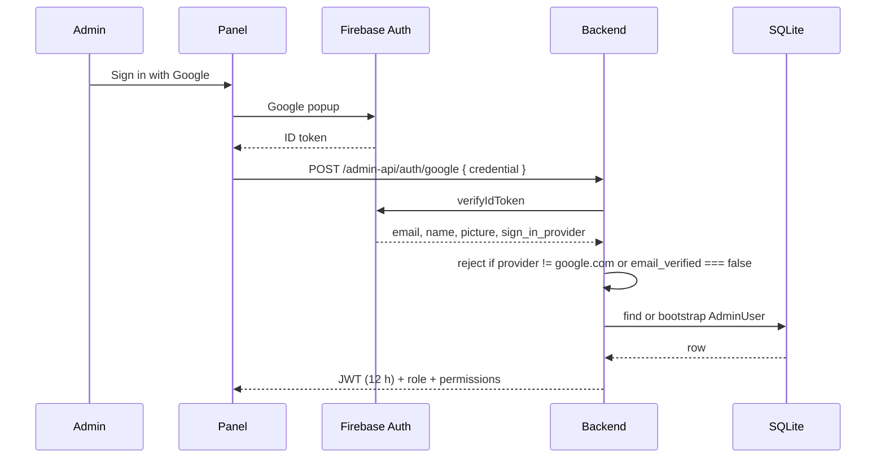
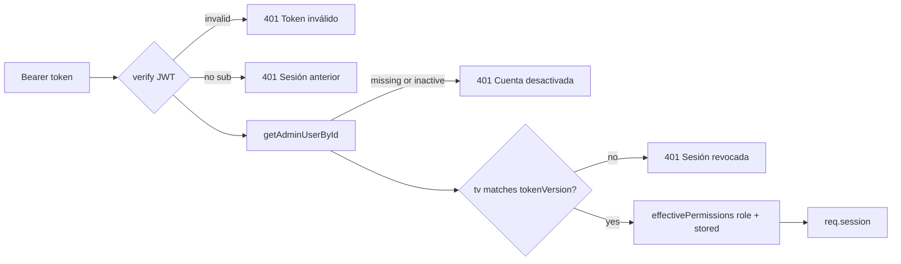

# Authentication and sessions

There are five separate authentication stories in this repository. They look
similar and must not be confused, because each one protects a different audience
and each one fails in a different way.

## 1. Panel login: Firebase → JWT



Rules enforced in `auth.service.ts`:

- Only `google.com` sign-in. Any other Firebase provider is a `403`.
- An unverified Google email is a `403`.
- The email is normalized to lowercase before any lookup, so `Juan@` and `juan@`
  are the same account.
- `ADMIN_WHITELIST` allows bootstrap accounts; `SUPERADMIN_EMAIL` is promoted to
  SUPERADMIN on first login. After that, the database is the authority and the
  environment no longer matters.

The JWT carries `sub` (database id), `email`, `name`, `picture`, `stationName`
and `tv` (`tokenVersion`). It does **not** carry permissions, deliberately.

## 2. Every authenticated request: reload from the database

`requireAuth` does more than verify a signature:



Consequences worth internalizing:

- Deactivating an admin or editing their permissions takes effect on the next
  request, with no waiting for token expiry.
- `POST /admin-api/users/:id/revoke` bumps `tokenVersion`, which invalidates every
  token issued before it. That is the whole session revocation mechanism; there
  is no session table to clean up.
- A 401 here is almost never a network problem. The messages are distinct on
  purpose so the panel can tell the user which one happened.

`requirePermission(...)` accepts a list and passes if the session has **any** of
them. `requireSuperAdmin` is separate and is used for user management, backups
and voice-key writes.

## 3. Panel secret: `/panel-api`

`/panel-api/*` is an AzuraCast proxy for authenticated panel sessions, guarded by
the `x-panel-secret` header (`PANEL_SECRET`) rather than a JWT. It exists so the
panel can read station status and start or stop AutoDJ without exposing the
AzuraCast API key to the browser.

If `PANEL_SECRET` leaks, the blast radius is the proxy, not the admin panel. They
are different credentials on purpose.

## 4. Webhooks

| Source | Endpoint | Guard |
| --- | --- | --- |
| Facebook | `GET/POST /webhook/facebook` | `x-webhook-secret`, verify token for the `GET` handshake |
| AzuraCast now-playing | `POST /api/station/nowplaying/update` | `x-webhook-secret` |
| YouTube hub | `GET/POST /admin-api/youtube/webhook` | none |

The YouTube webhook is intentionally unauthenticated and answers `200` before
doing any work. The hub retries on non-2xx, and a retry storm is worse than a
dropped notification: the channel poll every 15 minutes is the recovery path.
Unknown channels are discarded inside the handler, because the hub keeps pushing
for up to 24 hours after a channel is removed.

The router order in `app.ts` is part of the guard:

```ts
app.use("/admin-api/youtube", youtubeRouter);      // webhook: GET+POST, no auth
app.use("/admin-api/youtube", youtubeAdminRouter); // requireAuth on everything below
```

Reversed, the hub receives `401` and the subscription is never verified. The only
trace is a `202` the hub returns before checking anything, which is why this was
hard to notice.

## 5. Workers

Workers authenticate with a shared secret in their first message:

```json
{ "type": "register", "workerId": "...", "secret": "...", "name": "...", "maxConcurrentJobs": 2, "version": "1.4.2" }
```

Until `register` succeeds the socket is not associated with a worker and every
other message type is rejected with close code `1008`. Heartbeats and `pong`
only refresh liveness; they cannot elevate a connection.

Release downloads use `x-worker-secret` instead of the WebSocket session, because
the worker downloads before it connects.

## 6. Listener capabilities: `deviceId`

There is no listener account. The mobile app generates a `deviceId` and the
backend treats it as a bearer capability:

- `GET /api/prayer/my/:deviceId` returns every petition that device wrote,
  including the private `respuesta`.
- `POST /api/prayer/:id/answer-read` stamps the read receipt only if the
  `deviceId` matches the row, enforced inside the `updateMany` WHERE clause rather
  than a read-then-write.
- A wrong `deviceId` gets `404`, not `403`, so the route does not confirm that the
  id exists.
- A missing `deviceId` fails closed on the read receipt: there is nothing to prove
  ownership with.

This is a deliberate trade for an app with no sign-up, and it is the reason the
`deviceId` must never be logged or put in a URL that ends up in a proxy access
log if it can be avoided.

## Failure modes you will actually see

| Symptom | Cause | Where to look |
| --- | --- | --- |
| `401 Sesión anterior` | Token issued before the RBAC migration (no `sub`) | Force a new login |
| `401 Sesión revocada` | `tokenVersion` changed by a revoke or a role edit | Log in again |
| `401 Cuenta desactivada` | `isActive` false | `PATCH /admin-api/users/:id` |
| `403 No tienes permiso` | Role lacks the permission and it is not stored | Check effective permissions |
| `500 Firebase Auth no está configurado` | `FIREBASE_SERVICE_ACCOUNT_JSON` missing | Backend env |
| Infinite 401 on a fresh deploy | nginx not sending `X-Forwarded-For`, so `trust proxy` sees one global IP and the login limiter locks everyone | nginx config |

That last one is worth repeating: `app.set("trust proxy", 1)` assumes exactly one
proxy hop that appends the real peer to `X-Forwarded-For`. Without the nginx
directive, every request has `req.ip === 127.0.0.1`, the 30 attempts per 10
minutes limiter becomes a single global counter, and the whole station is locked
out at once.
