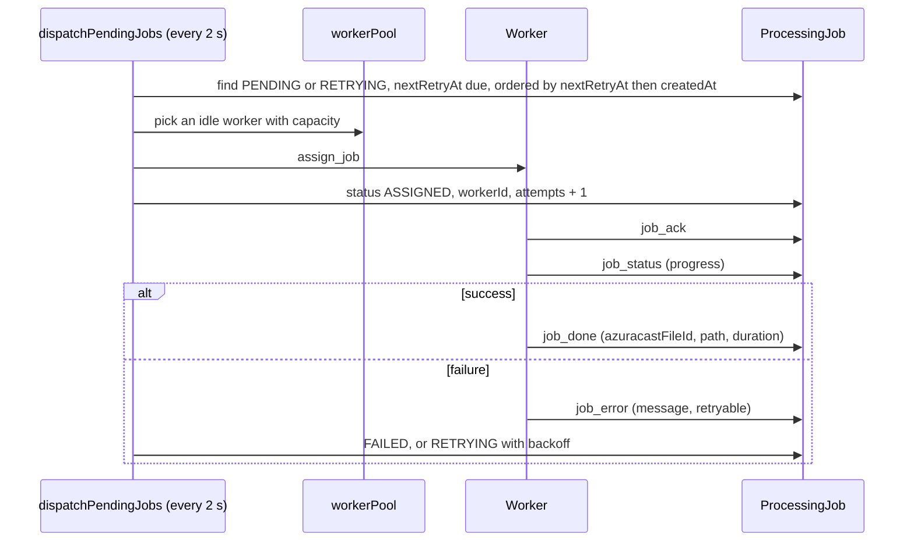

# Background jobs

Two very different mechanisms share the word "job" and must not be confused:

- **Crons** run inside the backend process, driven by `node-cron`. They are
  registered in one place: `backend/src/jobs/scheduler.ts`.
- **Processing jobs** are rows in `ProcessingJob`, dispatched over WebSocket to
  Windows worker nodes that do the CPU-heavy work (download, transcode, upload).

A cron can create processing jobs (YouTube polling does). A processing job never
schedules a cron.

## Registered crons

`startScheduler()` is called once at boot, after the settings cache is hydrated.
The order matters in exactly one place: the bumper reconciliation is registered
after the rotation because rotations rebuild the target playlist at 03:30 and
bumpers have to be re-applied on top of the rebuilt content.

| Cron | Expression | Job file | What it does |
| --- | --- | --- | --- |
| Announcement planning | `1 0 * * *` plus an interval | `locutor/playback.job.ts` | Replans today's slots, keeps pending ones |
| Folder cleanup | `0 7`, `0 13`, `0 19` | `azuracast/cleanup/folderCleanup.job.ts` | Deletes aired news files from AzuraCast |
| Job recovery | `*/5 * * * *` | `workers/jobRecovery.job.ts` | Re-queues jobs whose worker disappeared |
| Program notify | `1-56/5 * * * *` | `schedule/programNotify.job.ts` | Push for programs starting in 10 minutes |
| Listener sampling | `*/5 * * * *` | `azuracast/listenerHistory.job.ts` | One dashboard point |
| Playback capture | `*/5 * * * *` | `playback/playback.job.ts` | Mirrors AzuraCast history |
| Rotations | `30 3 * * *` | `rotation/rotation.job.ts` | Rebuilds target playlists |
| Bumpers | `*/5 * * * *` (`BUMPERS_SYNC_CRON`) | `bumpers/bumper.job.ts` | Re-pins intro/outro |
| GeoIP update | `0 3 * * 2,5` (`GEOIP_UPDATE_CRON`) | `devices/geoipUpdate.job.ts` | MaxMind + DB-IP refresh |
| Notice media cleanup | `15 4 * * *` | `notices/media/media.cleanup.job.ts` | Orphans older than 90 days |
| Health watchdog | `*/2 * * * *` (`health.checkIntervalMinutes`) | `health/health.job.ts` | Runs the check cycle |
| Programs archive | `*/5 * * * *` (`PROGRAMS_SYNC_CRON`) | `programs/program.playback.job.ts` | Aired detection + draft sweep |
| YouTube poll | `7,22,37,52 * * * *` | `youtube/youtube.subscription.job.ts` | Lease renewal + new uploads |
| Backup | `5 5 * * *` | `backups/backup.job.ts` | Runs the backup script |

Times are in the station time zone (`config.locutor.timezone`) where the job
passes `{ timezone }` to `cron.schedule`. The YouTube poll deliberately uses
minutes that are not round numbers: a restart at `:00` would otherwise collide
with every other job in the system.

## Manual triggers

Every cron above is also in `modules/systemJobs/systemJobs.registry.ts`, which is
what the panel's Jobs page lists. The registry is a catalog of
`{ key, label, description, schedule, requiresConfirm }` plus a runner map. A
manual run goes through `POST /admin-api/jobs/:key/run` with the `jobs`
permission, and `requiresConfirm` is what makes the panel ask first for
destructive ones (folder cleanup, rotations).

If you add a cron and forget the registry entry, the job still runs but an
operator has no way to trigger it from the panel. Add both.

## Processing jobs (workers)

The dispatcher runs on a `setInterval` (`JOB_DISPATCH_INTERVAL_MS`, 2 s), not on a
cron, because latency matters for a queue that a human is watching.

Worker state lives in memory (`workerPool.ts`): who is connected, what they are
running, how many jobs they accept. The database is the durable record; a backend
restart loses the pool and rebuilds it from reconnects, and `jobRecovery` requeues
anything that was mid-flight.

Heartbeats keep a worker alive; `WORKER_HEARTBEAT_TIMEOUT_MS` (60 s) plus a 30 s
ping cycle means a dead worker is noticed within about a minute.

## Retention and pruning

| Data | Retention | Where |
| --- | --- | --- |
| Playback events | 55 days | `playback/playbackHistory.ts` |
| Listener snapshots | pruned by the sampling job | `listenerHistory.service.ts` |
| Generated announcement audio | `expireOldAudios` | `locutor/audioGeneration.service.ts` |
| Program drafts | `PROGRAMS_DRAFT_TTL_HOURS` (12 h) | `programs/program.episode.service.ts` |
| Notice media | 90 days when orphaned | `notices/media/media.cleanup.ts` |
| Log lines read by the panel | depends on the log source, not the app | PM2 / nginx / docker |

## Adding a cron

1. Write `<name>.job.ts` with the body plus `register<Name>Job()`.
2. Register it in `jobs/scheduler.ts`, in the right position relative to jobs it
   depends on.
3. Add an entry to `SYSTEM_JOB_CATALOG` and `SYSTEM_JOB_RUNNERS` so the panel can
   run it manually.
4. If its schedule is configurable, read it from `config` (env or settings) and
   validate the expression with `cron.validate` — `geoipUpdate.job.ts` shows the
   pattern of falling back to a known-good expression and logging a warning.
5. If the threshold belongs to an operator, put it in the settings catalog
   instead of the environment. Remember that a value read once at registration
   (like the health interval) needs a restart, and the catalog should say so with
   `requiresRestart`.

Full procedure: `how-to/add-a-background-job.md`.
