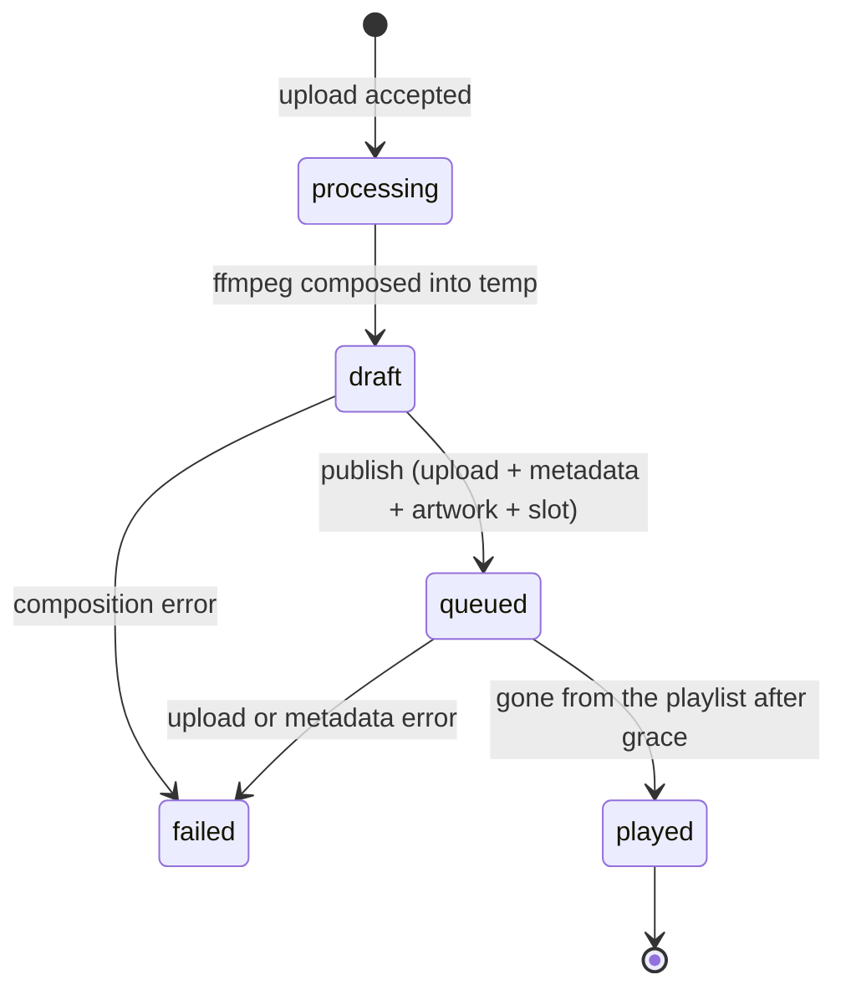
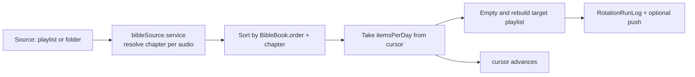

# Content pipelines

Four pipelines put content into the station. Each has a different source, a
different failure mode, and a different "did it work" signal.

| Pipeline | Source | Lands in | Detects success by |
| --- | --- | --- | --- |
| YouTube ingestion | Watched channels | AzuraCast media library | Worker report plus media id |
| Programs | Uploaded episode | AzuraCast playlist | Playlist membership |
| Rotations | Ordered source | Target playlist | Run log |
| Bumpers | Uploaded intro/outro | Playlist backend options | Reconciliation timestamp |

## 1. YouTube ingestion

```mermaid
sequenceDiagram
  participant C as cron (15 min)
  participant S as subscription.service
  participant Y as YouTube Data API
  participant I as ingest.service
  participant D as SQLite
  participant W as Worker (Windows)
  participant A as AzuraCast

  C->>S: refreshChannelSubscriptions()
  S->>D: load YouTubeChannel rows
  S->>Y: playlistItems.list (uploads playlist)
  Y-->>S: recent uploads
  S->>I: for each new videoId
  I->>D: create YouTubeVideo (unique videoId)
  I->>D: create ProcessingJob (PENDING, deadline)
  Note over I,D: duplicate videoId means push and poll<br/>reported the same upload; no second job
  D-->>W: assign_job over WebSocket
  W->>W: yt-dlp + ffmpeg
  W->>A: upload finished file
  W-->>D: job_done with azuracastFileId and path
```

Key decisions:

- **Ingestion is polling, not WebSub.** Verified on 31 October 2026: the public
  Atom feed answers `404` for a real channel and for an invented id, and the
  alternate path returns `200` with the same 463 bytes and no `<entry>` for both.
  The hub still answers `202`, but it emits before verifying the callback and the
  topic has nothing to publish. `channelUploads.service.ts` reads
  `playlistItems.list` on the uploads playlist instead (`UC…` → `UU…`), and the
  hub subscription is kept only in case YouTube restores the feed.
- **The channel row is the configuration.** `category` (`GENERAL` or `NEWS`)
  decides both the destination playlist (`workers/jobDispatcher.ts`) and the
  destination folder (`workers/workerAdmin.routes.ts`), through the same
  `channelCategoryOf()`. If those two diverged, a video would land in one
  category's playlist and the other's folder.
- **Unknown channels are discarded at the webhook.** The hub keeps pushing for up
  to 24 hours after a channel is removed, and without that guard the material of
  a channel the station deliberately dropped would still go on air.
- **`feedEntryCount` is the self-diagnosis.** `null` means never checked, `0`
  means the feed answered and had no videos. Adding a channel is not rejected
  when the feed is empty, because a channel can exist without YouTube reporting
  anything; the panel shows the `0`.

Worker jobs move through `PENDING`/`RETRYING` → `ASSIGNED` → `BUSY` →
`DONE`/`FAILED`/`IGNORED`, with `attempts`, `deadlineAt` and `nextRetryAt` on the
row. `jobRecovery.job.ts` every five minutes re-queues jobs whose worker went
away.

## 2. Programs (episodes produced outside the station)

A program owns an AzuraCast sequential playlist plus two library folders. The
admin flow is deliberately two steps so the episode can be heard before it airs.



- **Composition happens once, before publishing.** `prepare` joins
  `[intro?, body, outro?]` with the ffmpeg concat demuxer, re-encodes to
  128 kbps / 44.1 kHz / stereo (sources are non-professional recordings with mixed
  sample rates, so a stream copy skips on some players) and applies the optional
  edge fade. The result waits in `PROGRAMS_TEMP_DIR/<episodeId>/episode.mp3`.
  Publishing uploads that exact file, so the admin never pays for ffmpeg twice.
- **Loudness normalization does not use `loudnorm`.** In ffmpeg 8 both the dynamic
  and the linear two-pass mode discard the first ~3 seconds of the stream
  (measured: 12.0 s in, 9.10 s out), which silently eats the intro of every
  episode. The gain is measured with `ebur128` and applied with a static `volume`
  filter, capped by
  `min(target - measuredI, ceiling - measuredTP, maxGain)` so a too-dynamic source
  ends up quieter instead of clipping. `afftdn` (`reduceNoise`), `volume` and
  `afade` were verified to preserve duration.
- **Library layout**: `<PROGRAMS_ROOT_FOLDER>/<slug>/NO REPRODUCIDOS/<yyyy-mm-dd> - <titulo>.mp3`,
  and the same name under `REPRODUCIDOS` after airing. The date prefix keeps
  folder order chronological, which matters because archiving moves files rather
  than rewriting playlist order.
- **Aired is detected by playlist membership, not by history.** A sequential
  playlist drops an item once played, so `syncProgram` diffs the queued episodes
  against the playlist order and treats the ones that are gone as aired. Episodes
  younger than `PROGRAMS_PLAY_GRACE_MINUTES` are skipped so a queue write
  AzuraCast has not reflected yet is not mistaken for a play.
- **A linked playlist that already has schedule items is never touched.** Those
  items are the airing pattern the station owner defined, so `auto`/`manual`
  scheduling steps aside and the episode simply queues.
- **Drafts expire.** `discardStaleDrafts` sweeps unpublished previews after
  `PROGRAMS_DRAFT_TTL_HOURS`, run by the same archive cron.

`play_full_cycle` and `shuffle_enabled` no longer exist in AzuraCast and are
deliberately not sent. A sequential library playlist already drops an item once
played, which is exactly what archive detection relies on.

## 3. Rotations (Bible reading and other ordered material)



- **The source order is canonical, not alphabetical.** Resolving a chapter from
  metadata (`album` = book, `title` = "1 Reyes capitulo 4") and sorting by
  `order` + `number` is what makes `BIBLIA/OT` + `BIBLIA/NT` read in the right
  order; `path.localeCompare` sorts NT first.
- **`cursor` is the only mutable position**, and the announced chapter is read off
  the audio at `source[cursor]`, so the reading cannot drift from what is played.
  `bibleStartOrdinal` still exists in the schema but is no longer read or written.
- **Files whose chapter cannot be resolved** are kept at the end of the list,
  excluded from the announced chapters and reported through `unresolved` so the
  panel can show them instead of mis-announcing.
- **The source is cached for 10 minutes** with in-flight de-duplication, because
  resolving it walks the whole station library and used to exceed the 10 s admin
  request timeout. Uploads and deletes invalidate the cache.
- **The target playlist is emptied and rebuilt every night.** Anything pinned to
  it must be re-applied afterwards, which is why bumpers reconcile on their own
  cron.

## 4. Bumpers (intro and outro for multi-file programs)

A bumper is an intro and/or outro pinned to a playlist of N files, so the block
opens and closes as one piece.

- **AzuraCast does the gluing; the backend only writes options.** With
  `glued: true` the playlist gets `backend_options` with `merge` together with
  `single_track`, which AzuraCast's Liquidsoap generator turns into
  `merge_tracks(...)` and `predicate.at_most(1, {window})`. The two are written
  together on purpose: `single_track` alone would cut a news block down to one
  file.
- **Reconciliation is periodic, not one-shot**, because the rotation job rebuilds
  the target playlist at 03:30. The bumper cron runs after it in
  `jobs/scheduler.ts`.
- **`merge` breaks news cleanup.** Merged playback records one history entry, so
  the individual file `song_id`s never appear and `cleanupNewsFolder` stops
  recognizing them as aired. The news folder then grows without limit. News must
  stay `glued: false` until that detection is rewritten.
- **The prior state is snapshotted before writing options**, or there is nothing
  to restore when the bumper is disabled or deleted. `null` means no snapshot;
  `""` means the playlist had no options.
- **Guards on create**: the playlist must exist, must not be the general
  `AZURACAST_PLAYLIST_ID` (merging it would glue the whole day's music), must not
  belong to a `Program` (episodes are already glued by ffmpeg), and must not
  already have a bumper.

## 5. Notices (in-app content, not audio)

Notices are queried and displayed inside the app, not pushed. A notice carries a
window (`startsAt`/`endsAt`), an audience (`all`, `zone`, `platform`, `program`,
`devices`), a display mode (`toast` or `modal`), `maxDisplaysPerUser` and a
gallery of images and videos.

Media is optimized on upload (`sharp` for images, 720p H.264 plus a poster for
videos), stored under `backend/storage`, and served with immutable cache. Orphan
media older than 90 days is removed by a nightly cleanup.

## 6. Playback history mirror

`playback.job.ts` every five minutes copies the AzuraCast history into
`playback_events`, with a ten minute overlap between runs. `azuracastShId` is the
idempotency key, so the overlap is harmless and a failed run self-heals on the
next one. Retention is 55 days, not 90, because AzuraCast itself keeps about 60:
promising more would leave the coverage check permanently unsatisfied.

Metadata (`title`, `artist`, `album`, `playlist`, `streamer`) is copied into the
row instead of being resolved against the library, and `toRow` normalizes the
nullable contract fields (`playlist`, `streamer`, `duration`) because a single
`null` would abort the whole day's `createMany`.
