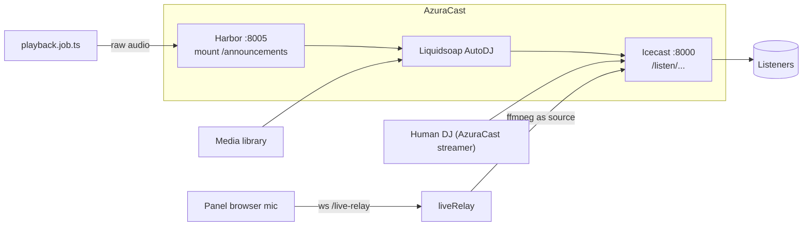
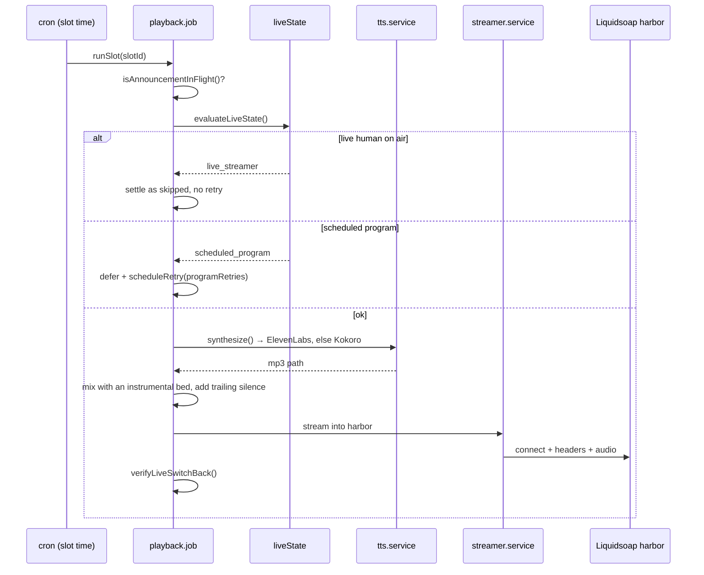

# Live audio

Four different things carry audio in this system, and they are easy to mix up:
the AutoDJ stream, a human streamer on Icecast, the browser relay from the panel,
and the hourly announcement pushed into Liquidsoap's harbor.

## The stream listeners play

`/listen/la_voz_de_la_verdad/` is proxied straight to AzuraCast on port 8080
(nginx snippet `proxy-stream.conf`, `limit_conn stream_conn 60`). The backend is
not in the audio path, which is why a backend restart does not interrupt
playback.

`/api/live/` is proxied to AzuraCast's own live websocket, separately from
`/live-status`, which is the backend's own SSE with the Facebook live URL.

## Live status: one boolean, persisted

`modules/live/sse.service.ts` holds the current live URL in memory, persists it
to `/var/www/radio/live-state.json`, notifies connected clients on change, and
pings every 30 s. `GET /live-status/` returns `{ active, url }`;
`GET /live-status/stream` is the SSE.

The persistence matters: the backend restarting must not make a live broadcast
disappear from every client for the length of the restart.

## A human DJ streaming from the panel

`modules/liveRelay/` is a WebSocket server attached to the main HTTP server at
`/live-relay` (`server.ts` forwards the upgrade). The browser sends Opus chunks
from the microphone; the backend runs ffmpeg as an Icecast source client using
the DJ's own AzuraCast streamer credentials, which are fetched server-side and
never sent to the browser.

Guards:

- The first message must authenticate the JWT within 10 seconds, and the user
  must have `live` or `streaming`.
- Chunks are capped at 256 KB each.
- `LIVE_MAX_SESSION_MINUTES` (240) caps a session; `LIVE_RECONNECT_GRACE_SECONDS`
  (20) allows a reconnect before the session is dropped.
- `POST /admin-api/djs/relay/stop` and `POST /admin-api/live/clear` exist so an
  operator can end a stuck session without restarting anything.

`LIVE_ICECAST_HOST` empty means "hostname of the AzuraCast public URL", and
`LIVE_ICECAST_MOUNT` empty means `/<stationId>`. Both defaults are intentional:
a fresh deployment works without knowing the Icecast topology.

## Announcements: the hardest path in the repository

There are three separate questions, answered by three separate modules:

| Question | Module | Output |
| --- | --- | --- |
| Where in the day should announcements go? | `announcementPlan.service.ts` | `AnnouncementSlot` rows for today |
| Is this still a good moment? | `liveState.service.ts` | `ok` / `live_streamer` / `scheduled_program` / `unknown` |
| How does the audio reach the air? | `playback.job.ts` + `streamer.service.ts` | Bytes into the harbor |

### Why the budget counts emissions, not attempts

`announcements.perDay` is compared against `played` slots for the station day. A
slot that was blocked or failed does not spend budget, so a day of live programs
does not silently consume the allowance.

### Why the plan is re-made but pending slots are kept

`rescheduleAnnouncements()` runs at 00:01 and then on an interval. It keeps the
pending slots that are still ahead and only draws the ones that are missing,
marking the surplus as `skipped`. Rebuilding the whole plan every cycle used to
give away budget and move announcements that had already been chosen.

### Retry policy depends on the reason

| Reason | Behaviour |
| --- | --- |
| `live_streamer` | No retry. A person is on air; hammering every five minutes only fills the log. |
| `scheduled_program` | Retry up to `announcements.programRetries` (default 3) |
| `unknown` | Discard. If the state cannot be read, there is no basis to claim the window is still free. |

### The harbor identity trap

The announcement streamer account is created as `avsisos_auto` with
`display_name = STATION_NAME`. AzuraCast reports the **display name**, not the
login, in `now_playing.live.streamer_name`.

`liveState.service.ts` originally compared only against the login, so the
station's own announcement read as a human. `liveIsOwnAnnouncement` was false,
`verifyLiveSwitchBack()` took the safety branch that never disconnects, and the
harbor stayed occupied. On 30 October 2026 the station had been blocked for over
a day with the streamer account connected and the radio silent.

`streamer.service.ts` now recognizes the account by login **and** display name
(`getAnnouncementStreamerIdentities()`, 5 minute cache) and reads the user from
`announcements.streamerUser`. The password lives encrypted in
`announcement_streamer_credentials` (AES-256-GCM with `SECRETS_ENCRYPTION_KEY`),
is write-only from the panel, and the panel only learns
`stored`/`missing`/`unreadable`.

Before synthesizing, `playback.job.ts` releases the harbor if the announcement
account holds it, so one badly closed announcement does not block the rest of the
day. `POST /admin-api/locutor/live/release` does the same by hand and never cuts
a person.

### Timeouts scaled to the file

The stream timeout is `audio duration + 15 s`, minimum 30 s. A fixed 30 s used to
cut any announcement longer than that with the audio half sent.

### The watchdog as a last resort

The health check releases an own live source that has been held longer than
`announcements.stuckLiveMinutes` (default 5) with no announcement in progress,
using AzuraCast's `broadcast_start`. This is the automated backstop for the trap
above, not a substitute for fixing identity detection.

## The voice engine

`synthesize()` is the only entry point, and it walks a fixed provider list:
ElevenLabs first, then Kokoro. A provider that reports itself unavailable is
skipped without spending a request, so a station with no key configured behaves
exactly as before.

The key pool (`tts/apiKeyPool.service.ts`) keeps three failure kinds distinct:

| Failure | Parking |
| --- | --- |
| `invalid_api_key` (401) | Process lifetime |
| `quota_exceeded` | Until the reset date reported by the subscription endpoint |
| Anything else (429 concurrency, 5xx, timeout) | Two minutes |

Collapsing those into "key unusable" is the bug to avoid: a transient 429 would
retire a key that still has credits. Reservation is round-robin with an in-flight
counter, so two concurrent generations do not both spend the last key.

The template voice stays provider-neutral (`ef_dora`), ElevenLabs maps it through
`ELEVENLABS_VOICE_IDS` / `voice.voiceMap`, and what actually produced a file is
recorded on the row as `elevenlabs:<id>` or `kokoro:<voice>`.

Measured on 8 October 2026: the free ElevenLabs plan allows 10 000 characters per
month and a 100-character announcement is 6.7 s of audio, roughly 100
announcements per account per month. That is the number that sizes the pool.

## Debugging on-air problems, in order

1. `GET /admin-api/locutor/status` — which engine would answer, key states,
   balance.
2. `GET /admin-api/locutor/announcement/live-state` — would it announce now, and
   why not.
3. AzuraCast `now_playing.live.streamer_name` — is the announcement account or a
   human holding the harbor.
4. `GET /admin-api/health/watchdog` — is a check already reporting it.
5. `POST /admin-api/locutor/live/release` — free the harbor before trying again.
