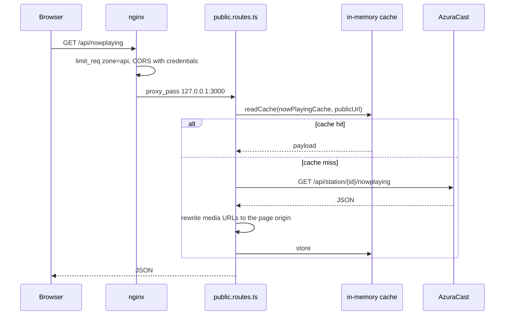
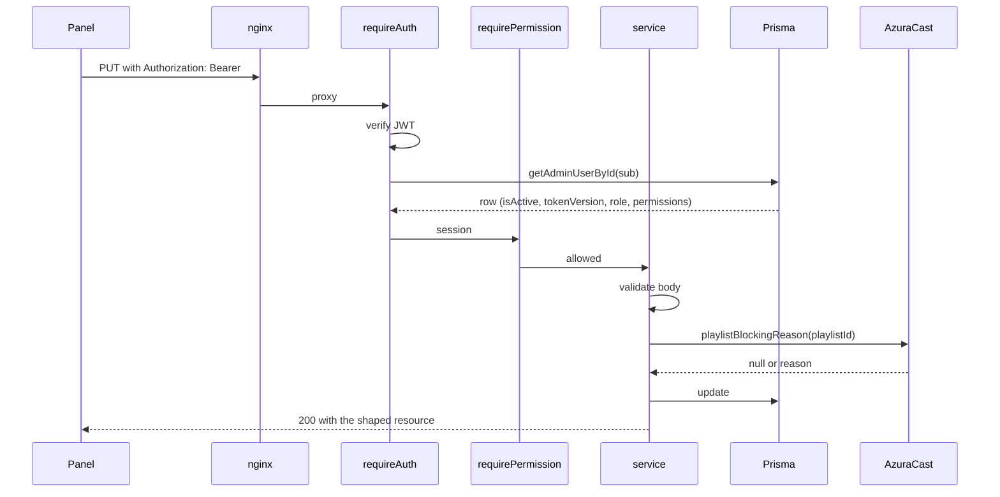

# Request lifecycle

Three request kinds behave differently enough to be learned separately: a public
read, a panel write, and a stream. Most bugs come from applying the rules of one
to another.

## A public read: `GET /api/nowplaying`

Three things are intentional:

- The cache key includes the public URL, not just the endpoint, because the
  rewrite depends on the origin the client used.
- Media URLs are reduced to the page origin before they leave the backend. The
  CSP allows `https:` and `blob:` for images, so an `http://` origin would be
  blocked, and an absolute foreign origin would fail on any other host.
- The endpoint never forwards AzuraCast credentials. `AZURACAST_API_KEY` is used
  server-side by `azuracast.client.ts` and never serialized.

`SILENT_LOG_PATHS` in `app.ts` excludes the paths the panel polls
(`/admin-api/logs`, `/health`, `/admin-api/health`, `/api/health/public`,
`/admin-api/feedback`, `/admin-api/playback`). Without that, each poll writes a
morgan line into the PM2 file that the panel's own log viewer reads, and the log
becomes a recording of itself.

## A panel write: `PUT /admin-api/programs/:id`

The important detail is the database round trip inside `requireAuth`. The JWT
carries only `sub`, `email` and `tv`; role and permissions are read from the row
on every request. That is what makes deactivating an admin or changing
permissions take effect immediately, and what `tokenVersion` is for: a revoked
session fails the `tv` comparison instead of waiting for the 12 h expiry.

Validation happens before the service is called and before any external request.
When a change depends on AzuraCast state (a playlist must be sequential, for
example), the external check happens inside the service and returns a `409` with
the reason, not a generic failure.

## An authenticated stream: prayer SSE

`EventSource` cannot send an `Authorization` header, so the panel does this:

1. `POST /api/prayer/events/ticket` with its JWT → `{ ticket }`, single use.
2. `GET /api/prayer/stream?ticket=...` → SSE.

The ticket is consumed on first use, so a leaked URL in a proxy log is not a
permanent credential. The same pattern would apply to any future SSE endpoint
that needs authentication.

The public live status stream (`/live-status/stream`) needs no ticket: it carries
the Facebook live URL and nothing else. It does carry connection budget: nginx
counts it in `sse_conn` (40 concurrent per IP), separate from `stream_conn` (60),
because a single tab holds the audio stream and one or more SSE connections at
the same time.

## Uploads

Uploads never pass through `express.json`. They are multipart handled by multer,
and each destination has its own nginx body limit:

| Endpoint | Limit | Destination |
| --- | --- | --- |
| `/admin-api/upload` | 200 MB | AzuraCast media library |
| `/admin-api/workers/upload` | 100 MB | Worker-finished video |
| `/admin-api/notices/videos` | 130 MB | Notice video library |
| `/admin-api/notices/images` | 25 MB | Notice image library |
| `/admin/worker-releases` | 50 MB | Release ZIP |

Local file uploads go to disk (`diskStorage`), not into memory, so a 130 MB video
does not become a 130 MB buffer in a process that also serves audio status.

## Static media

`/media/notices`, `/media/notice-videos` and `/media/program-art` are served by
Express with long cache headers, and nginx only proxies `/api/*` to the backend.
That is why `apiUrl()` rewrites `/media/...` to `/api/media/...`, and why `app.ts`
mounts both forms. Program art is cached for a day instead of immutable because
the filename changes when the image is replaced.

## What the browser does with failures

The public player reconnects with backoff and surfaces the attempt count. The
admin API calls surface the backend error message, except for 5xx, where the
generic message is shown and the detail goes to the log. Nothing leaks a stack
trace: `error-handler.ts` is the only exit.

If a panel action hangs longer than 10 seconds, look at the endpoint before
blaming the network. `/admin-api/rotations/:id/source` and `/align` walk the
station library and are given a 120 s timeout on purpose; everything else is
expected to answer quickly.
