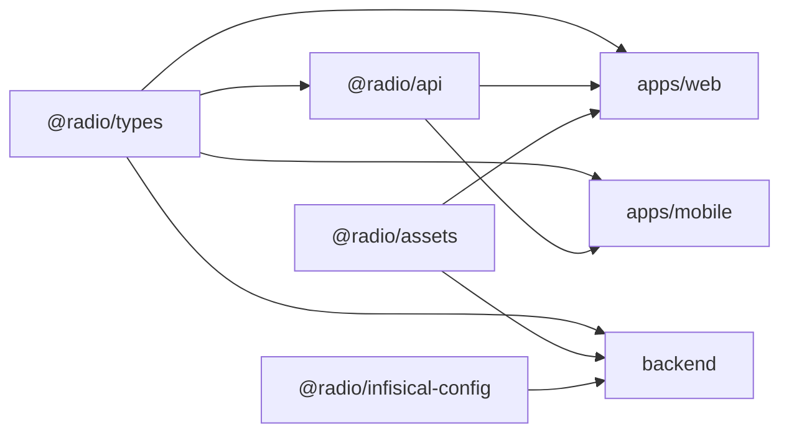

# Shared packages

Four workspace packages. Two of them are contracts (`types`, `api`), one is
content (`assets`), one is bootstrapping (`infisical-config`). They are the reason
the web app, the mobile app and the backend agree on shapes.

## `@radio/types`

Pure TypeScript: interfaces, unions, label maps and limits. No runtime
dependencies, no I/O. If a value is shared by more than one app and is not a
function, it belongs here.

| File | Contains |
| --- | --- |
| `admin.ts` | `AdminRole`, `AdminPermission`, `ADMIN_PERMISSIONS`, label maps, `hasAdminPermission`, and the payloads of nearly every panel feature: users, DJs, playlists, schedule, locutor, devices, push, rotations, programs, bumpers, notices, workers, YouTube, backups, health, playback, settings, voice keys |
| `azuracast.ts` | `NowPlayingData`, `Station`, `Song`, `SongHistory`, `StationStatus`, `StreamQuality`, `PlayerState`, `AudioMetadata` |
| `bible.ts` | Translation, book, chapter and search response shapes |
| `catalog.ts` | The exported public catalog consumed by the generated pages |
| `feedback.ts` | `FEEDBACK_CATEGORIES`, `FEEDBACK_STATUSES`, `FEEDBACK_LIMITS` (`mensaje` 800, `nombre` 60, `contacto` 120), `FEEDBACK_MIN_MENSAJE` (10), request and response payloads |
| `prayer.ts` | `PRAYER_STATUS`, `PrayerRequest` with both read markers, list responses, `MyPrayerRequestsResponse`, device payloads |

Two constants deserve attention because both the browser and the server read
them, which is the only way their validation cannot drift:

- `FEEDBACK_LIMITS` and `FEEDBACK_MIN_MENSAJE` are used by
  `validateFeedbackSubmission` in the backend and by the client-side form.
- `ADMIN_PERMISSIONS` is the list the backend validates stored permissions
  against and the list the panel renders.

The prayer module is the known exception: `apps/mobile/lib/prayer.ts` still keeps
its own `PrayerItem` instead of importing `@radio/types`. Widening the shared
contract and migrating the app should happen in the same change.

## `@radio/api`

The HTTP layer for listener surfaces, used by web and mobile.

| Export | Purpose |
| --- | --- |
| `fetchSchedule` | Weekly schedule from `/api/schedule` |
| `fetchScheduleCategories` | Category list |
| `fetchRequestableSongs` | Library search for song requests |
| `requestSong` | `POST /api/requests/:songId` |
| `submitFeedback` | Returns `{ success: true } \| { success: false, errorMessage }` instead of throwing |
| `mergeConsecutiveScheduleItems` | Collapses adjacent identical schedule slots into one row |
| `rewriteLocalhostUrls` | Rewrites a loopback origin in media URLs to the configured base |
| `toSameOriginMediaUrls` | Reduces absolute `/api/station/...` URLs to the page origin |
| `fetchBibleSearch`, `splitBibleText`, `isBibleSearchResponse` | Bible search plus safe highlight splitting |
| `useAzuraCast` | The now-playing hook shared by both clients |

The two URL helpers exist because of one production failure: artwork and media
arrive as absolute URLs built from whatever origin the deployment used. An
`http://` URL, or any origin other than the page's, is blocked by the site CSP
(`img-src 'self' data: https: blob:`) or rejected as mixed content. The scope is
deliberate: only `/api/station/` is normalized, because `station.mounts[].url`
and `listen_url` also point at the ICEcast server and reducing those would break
playback.

`submitFeedback` returns a discriminated union on purpose. A caller renders
`errorMessage` inline; there is no exception to forget to catch.

## `@radio/assets`

Binary and large content: the logo set, the instrumental beds used under
announcements (`announcements.bedsDir` defaults to `../packages/assets/audio`),
and the Bible XML corpus.

The Bible corpus is a **git submodule**. A clone without `--recurse-submodules`
leaves it empty, and `seed:bible:published` then has nothing to read.

## `@radio/infisical-config`

`initializeInfisicalSecrets()` loads secrets into `process.env` before any config
module is imported, using `INFISICAL_CLIENT_ID`, `INFISICAL_CLIENT_SECRET`,
`INFISICAL_PROJECT_ID`, and optionally `INFISICAL_ENVIRONMENT` (default `dev`),
`INFISICAL_SITE_URL` and `INFISICAL_SECRET_PATH`.

It returns a boolean and never throws on a missing configuration: an absent
setup leaves the local `.env` in charge, which is the state of a development
machine. `initializeInfisicalSecrets` is awaited at the top of
`backend/src/index.ts`, and everything else is imported dynamically after it.

`setup.ts`-style scripts that need config must reproduce that order, or they hit
`Env X is not defined` at import.

## Dependency direction

Nothing depends on an app. `apps/web/tests/perf/import-boundaries.test.ts` exists
to keep that true: an import that reaches into another workspace's `src/` fails
the suite.
